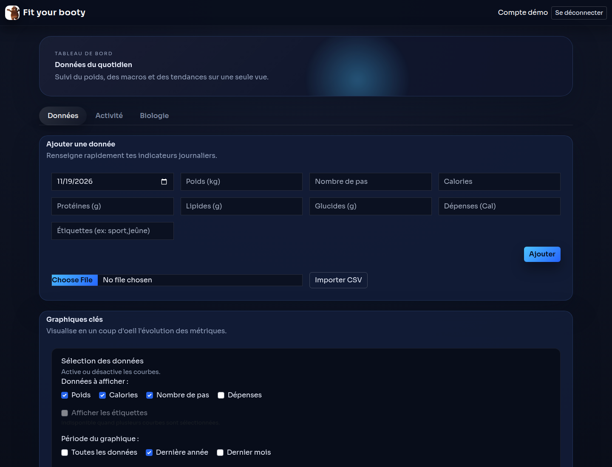
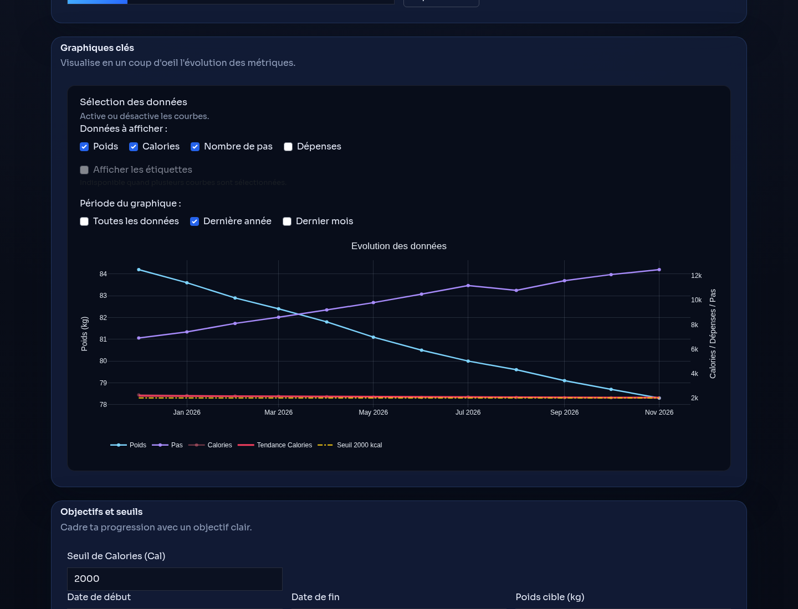
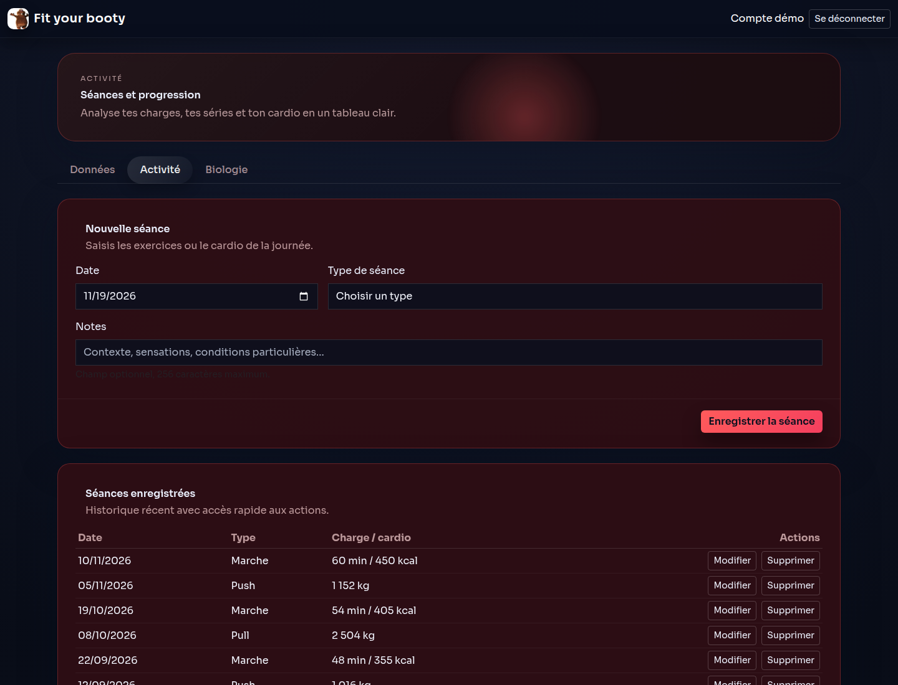
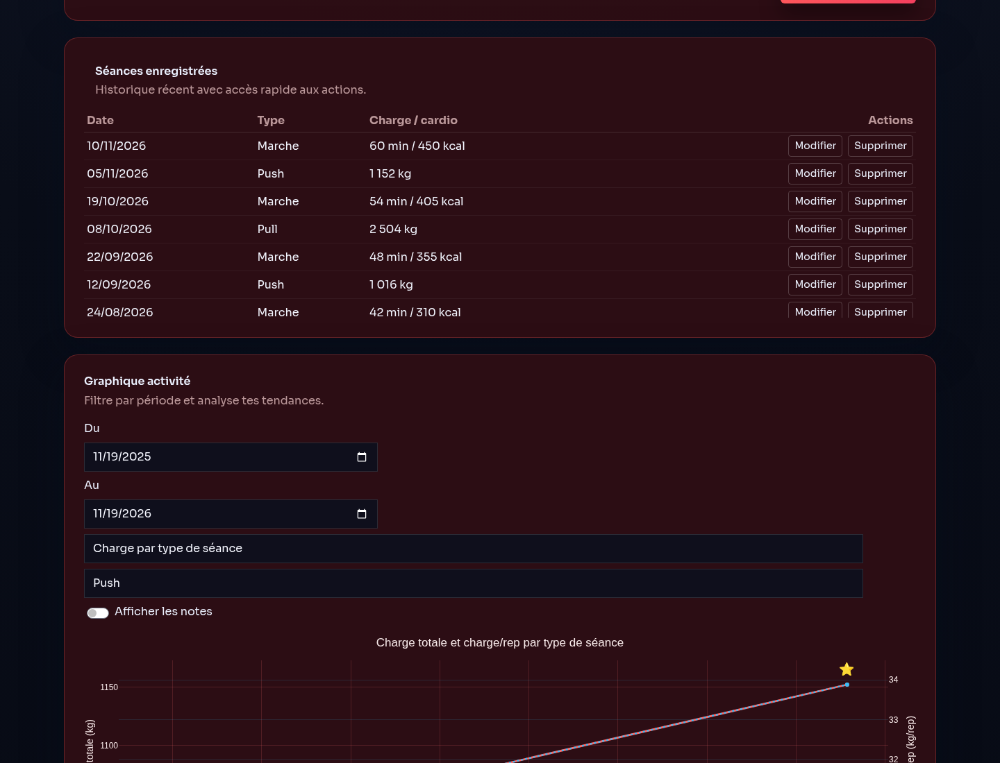
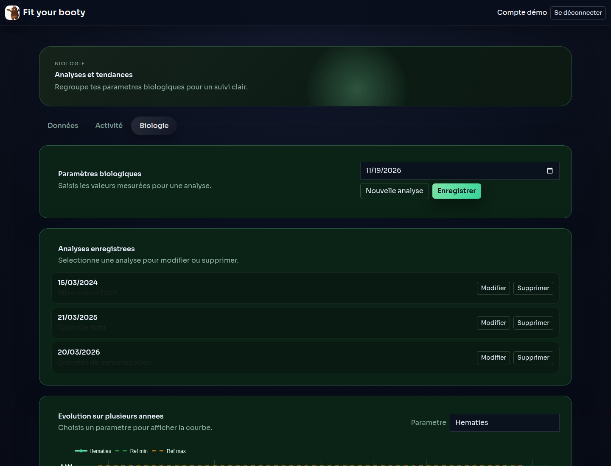
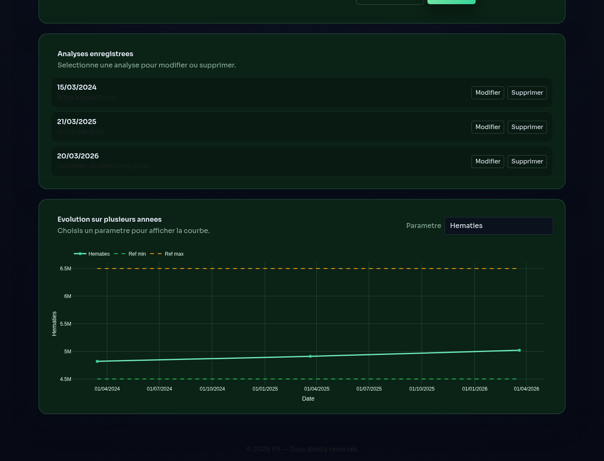
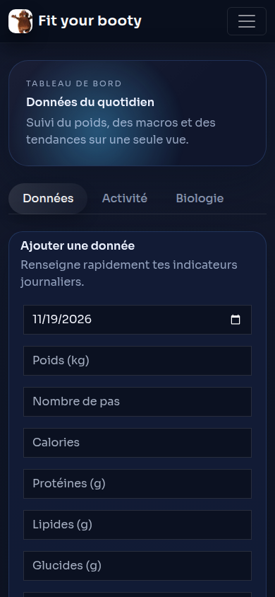

# FIT YOUR BOOTY

Application web permettant de suivre ses données personnelles  nutritionnelles, sportives, et de santé. 

Site en production : [https://fit.vatinel.fr] 

! Création de compte soumis à procédure Auth ! 

!! Destiné à utilisation privée le site en production ne respecte pas la reglementation RGPD (clonez plutôt le repo) !! 


### L'application se divise en trois onglets
* Nutrition & Neat : Suivi des calories, macro, poids, steps, dépense énergétique
     répartie en 3 cards :
    
              - formulaire d'entrée des données
              - graphique plotly pour le suivi chronologique des métriques
              - tableau récapitulatif des entrées avec possibilité de modification


* Sport  : Suivi des séances de sport cardio / musculation.
              
            - choix des séances / exercices / métriques.
            - graphique plotly pour le suivi chronologique des métriques selon plusieurs aggrégations.
            - administration des exercices et des séances (créations personnalisables).
  
* Santé  : Suivi de marqueurs biologiques d'analyse sanguine.
  
          - formulaire d'entrée des données
          - tableau d'édition des analyses enregistrées
          - graphique plotly pour le suivi chronologique des marqueurs


## Aperçu de l'application

> Les captures ci-dessous utilisent exclusivement des données fictives créées pour la démonstration.

### Nutrition, NEAT et suivi du poids

<p align="center">
  
  
</p>

### Activité sportive

<p align="center">
  
  
</p>

### Suivi biologique

<p align="center">
  
  
</p>

### Version mobile

<p align="center">
  
</p>


Le projet est déployé sur un **VPS Linux** et le code est versionné via **GitHub**.

---

# Stack technique

* Laravel
* PHP 8+
* MySQL / MariaDB
* JavaScript
* Plotly.js
* Git / GitHub
* VPS Linux (Ubuntu)

---

# Installation locale

Cloner le projet :

```
git clone git@github.com:SebV-code/FitYourBooty.git
cd FitYourBooty
```

Installer les dépendances :

```
composer install
```

Créer le fichier `.env` :

```
cp .env.example .env
```

Générer la clé Laravel :

```
php artisan key:generate
```

Configurer la base de données dans `.env`.

Puis lancer les migrations :

```
php artisan migrate
```

Démarrer le serveur local :

```
php artisan serve
```

Application disponible sur :

```
http://localhost:8000
```

---

# Documentation

La documentation technique complète est disponible dans :

```
/docs
```

* architecture.md
* deployment.md
* database.md
* dev-workflow.md
